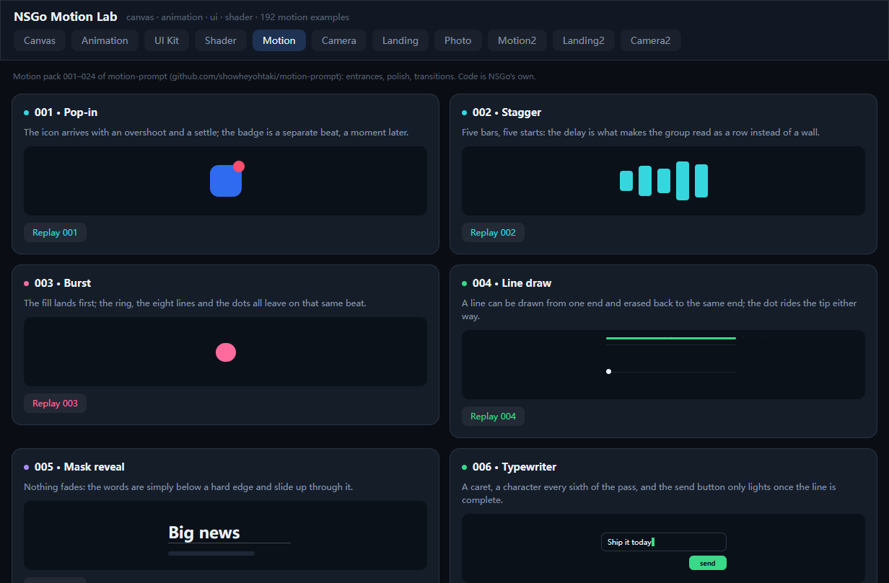
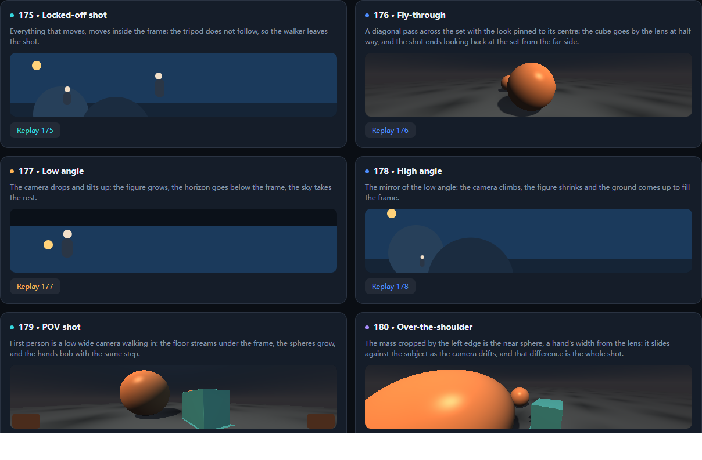
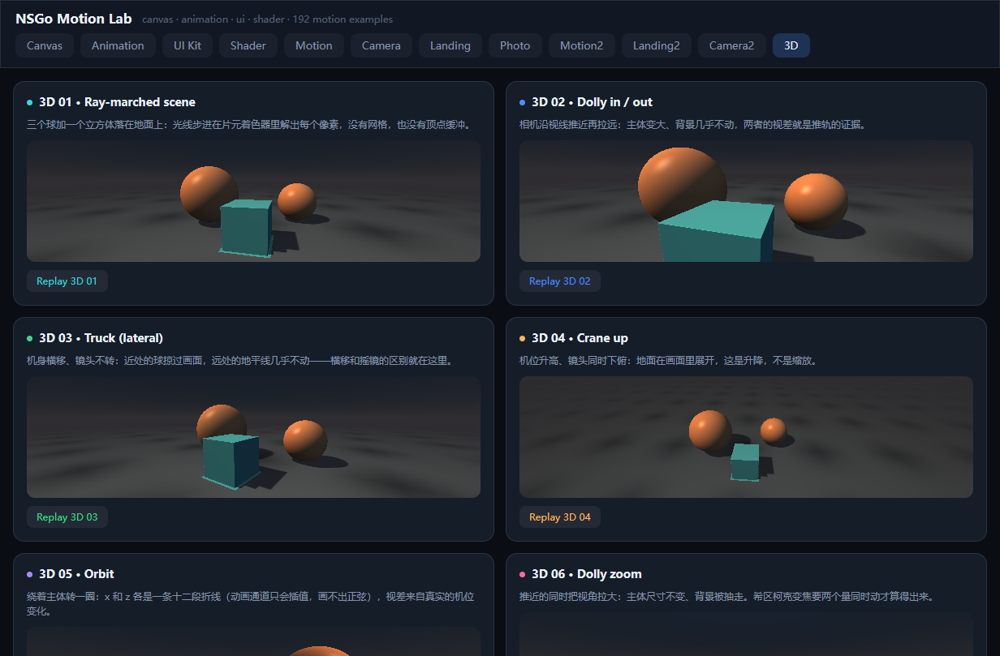
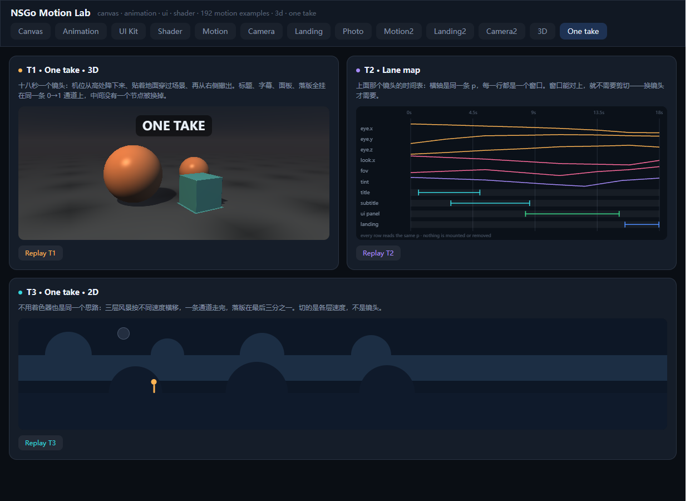

# nsgo-motion-lab

一个 NSGo 工程，两半：**写 NSGo 应用的规矩**（`SKILL.md`，可装成 DSH 技能）和**把规矩跑一遍的现场**（`lab/`，13 个页签、234 张卡片）。

规矩不是想出来的，是从 lab 里踩出来的。



## 目录

| 路径 | 是什么 |
| --- | --- |
| `SKILL.md` | 技能本体：NSGo 的 API 铁律、动画与 3D 的写法、踩过的坑 |
| `references/api.md` | 逐条 API 事实（信号、`View`/`Text`/`Button`、样式、布局、组件、服务、打包） |
| `references/animation.md` | 动画：两套时钟、`AnimatedStyle`、曲线、弹簧、shader 驱动的动效 |
| `lab/` | 可运行的 Go 应用 Motion Lab，把上面每条规矩实现一遍 |
| `lab/README.md` | 逐页签的技术说明（写卡片时踩的坑都在这里） |

仓库根目录本身就是一个合法的技能目录（`SKILL.md` + `references/`），所以「装技能」＝让 DSH 指向这个 checkout，不需要额外的打包步骤。

## 为什么合在一个仓库

技能里的每一条规矩，出处都在 `lab/` 里：

- `AnimatedStyle` 只做插值，没有表达式 → 3D 相机绕圆只能拿折线逼近（`lab/page_3d.go` 的 `circleLane`、`lab/page_camera.go` 的 `arcLane`）。
- `Scroll` 必须有被约束的高度，否则它撑到内容高度、永远不滚 → `TestScrollFitsWindow` 守着这个回归。
- `BackfaceHidden` 在 web 上会把正反两面一起隐藏 → 翻面卡改用 `Opacity` 按角度交叉淡入。
- 插值出来的颜色别带 alpha，否则渲染成接近纯色 → 开关轨道改成两个不透明色。

反过来，`lab/README.md` 里每张卡片的写法，都能在 `references/` 找到对应的 API 事实。一处改、两边同步，不用在「技能说 A、示例做 B」之间猜。

## 装技能

DSH 启动时扫 `~/.dsh/skills/*/SKILL.md`，把技能目录指到 checkout 就行（改仓库即改技能）：

```bat
mklink /J "%USERPROFILE%\.dsh\skills\nsgo" "%CD%"
```

不建链接也行，把两份东西复制过去：

```bat
mkdir "%USERPROFILE%\.dsh\skills\nsgo" 2>nul
copy SKILL.md "%USERPROFILE%\.dsh\skills\nsgo\"
xcopy /E /I references "%USERPROFILE%\.dsh\skills\nsgo\references"
```

装完新开一个 DSH 会话，`nsgo` 技能就在目录里了。注意两点：目录名和 frontmatter 的 `name` 都叫 `nsgo`；如果那个路径已经存在且**正在被删**（Windows 会一直回 `Access is denied`），等占用它的进程退出再装。

## 跑 lab

要求 Go 1.26+（`go.mod` 写的是 1.27.1）。NSGo 是 pre-release，本仓库 pin 在一个 commit 上。

```sh
cd lab
go tool nsgo dev -target web -open=false -port 8099 .   # 浏览器里看
go test .                                               # 6 个测试
go tool nsgo build -target windows_x64 .                # 打出 dist/
```

## 里面有什么

13 个页签、234 张卡片：

| 页签 | 内容 |
| --- | --- |
| Canvas · Animation · Shader | 30 张手写基础示例（画布 6 / 动画 4 + 16 个 preset / 着色器 4） |
| Motion · Camera · UI Kit · Landing · Photo · Motion2 · Landing2 · Camera2 | [motion-prompt](https://github.com/showheyohtaki/motion-prompt) 目录的 8 个包 × 24 = 192 个动效，一个不落 |
| 3D | 光线步进场景、CPU 投影立方体、CSS 3D 翻面，9 张 |
| One take | 一镜到底：一条 `0→1` 通道跑完一个镜头，3 张 |

camera 包里有 5 张（`030 Orbit`、`031 Crane up`、`176 Fly-through`、`179 POV`、`180 Over-the-shoulder`）不满足于二维近似，直接跑在光线步进场景上——相机只是一组 uniform，平台按帧推进，零 commit：




## 一镜到底

卡片回答的是「一段动效怎么好看」，一镜到底问的是另一件事：**十几段怎么拼成一条不断的时间**。`One take` 页签是三个答案（`lab/page_one_take.go`）：

- **T1 · One take · 3D** —— 18 秒，一条 `p: 0→1` 同时喂 8 条相机 lane（`eye.x/y/z`、`look.x/y/z`、`fov`、`tint`）和 4 个文字窗口，机位从高台上落下来、贴着地面穿过道具、再从右侧升出去。
- **T2 · Lane map** —— 上面那个镜头的时间表：横轴是同一条 `p`，每行一个通道。**窗口能对上，就不需要剪切**；要换的才叫切点，这张图上没有。
- **T3 · One take · 2D** —— 不用着色器也一样：两层山脊按 1:4 的速度横移，走者踩在近处那层上（同一条通道，所以人不会跟地面错位），落版在最后三分之一。

三条规矩：

1. **`p` 必须对时间线性**。窗口写的是「第几秒到第几秒」，不是「第几帧到第几帧」，所以主通道用 `core.Easing{Bezier: core.Linear}`（`FxSpec.Linear`），缓动只放在每个窗口内部——否则窗口的边界会跟着缓动一起漂。
2. **什么都不挂载、什么都不卸载**。藏起来就是 `Opacity 0`。一旦有 `if` 决定渲染，时间就断了：重新挂载的节点从零开始，那一下就是剪切。
3. **字幕自带底**。片元着色器不知道身后是什么颜色，20pt 白字压在橙色球上读不出来；每段字幕配一块 `RGBA(0,0,0,0.5)` 的板。



## 已验证的事实

- `go build .`、`go vet .`、`go test .` 全过；Windows 产物 13.0 MB，能起。
- 192 张卡片的编号 001–192 无重复、无缺号（`TestPackPages` 守着）。
- 着色器在运行时编译，编译失败就是 panic，所以 `TestShadersCompile` 用 `core.CompileShader` 把每份源码过一遍。
- 页签切换、UI kit 的组件状态、控件是否真的连到信号，各有测试（`TestTabsSwitchPages`、`TestUIKitControls`、`TestControlsAreLive`）。
- 一镜到底的三张也进 `TestTabsSwitchPages`：切到 `One take` 要能摸到三张卡的标题和两个 Replay。
- 「同一个镜头」是拍出来验过的，不是看着代码推的：`lab/shots/take.js` 用 CDP 在 0.5s/3s/6s/9s/12s/15s/17.9s 各截一帧，逐帧看构图有没有断（`lab/shots/` 已 gitignore）。

## 许可与致谢

本仓库以 MIT 发布。卡片的名字、分类和时长来自 [motion-prompt](https://github.com/showheyohtaki/motion-prompt)（MIT），代码全部是 NSGo 自己的原语，没有移植上游任何一行。引擎是 [oneo-me/nsgo](https://github.com/oneo-me/nsgo)，许可归其作者；设计源自 [NSH](https://github.com/longbridge/nsh)。
