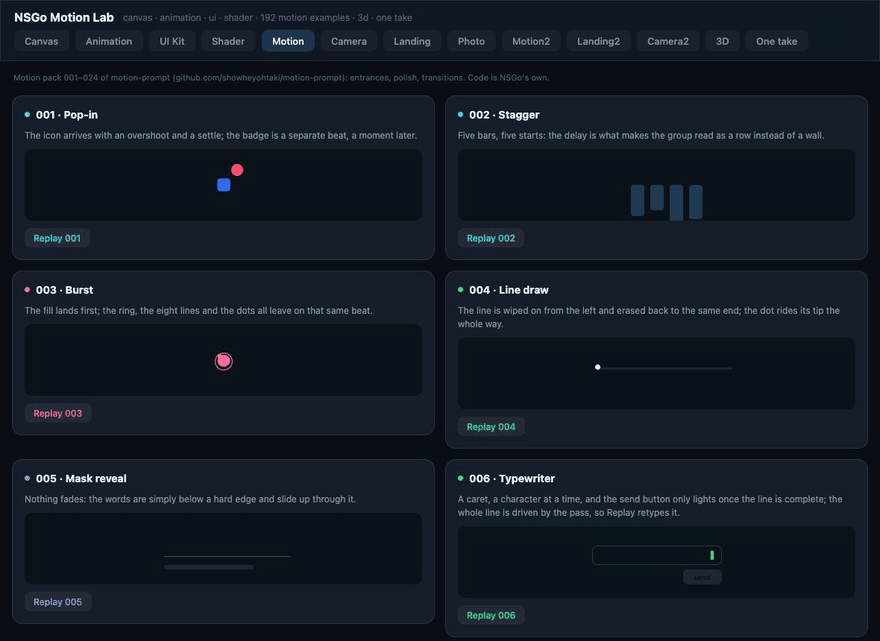
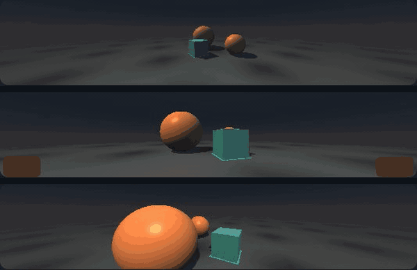
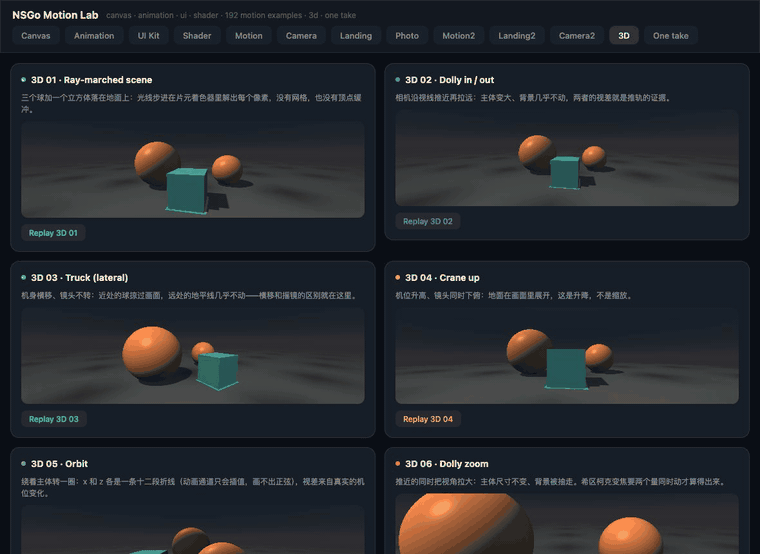
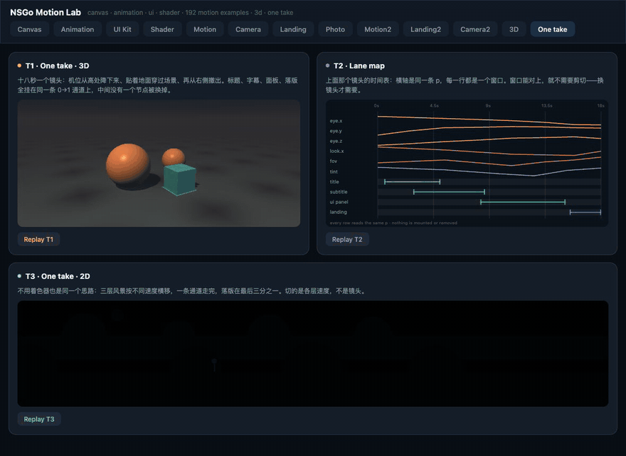

# nsgo-motion-lab

一个 NSGo 工程，两半：**写 NSGo 应用的规矩**（`SKILL.md`，可装成 DSH 技能）和**把规矩跑一遍的现场**（`lab/`，14 个页签、237 张卡片），再加一套**把动效拍成片子**的框架（`film-framework/`）。

规矩不是想出来的，是从 lab 里踩出来的。



## 目录

| 路径 | 是什么 |
| --- | --- |
| `SKILL.md` | 技能本体：NSGo 的 API 铁律、动画与 3D 的写法、踩过的坑 |
| `references/api.md` | 逐条 API 事实（信号、`View`/`Text`/`Button`、样式、布局、组件、服务、打包） |
| `references/animation.md` | 动画：两套时钟、`AnimatedStyle`、曲线、弹簧、shader 驱动的动效 |
| `references/keyframe.md` | 节点分镜：`Take`/`Node`/`Keyframes`/`Seek`/`Lint`，与 three.js 的对照，导出与自检 |
| `lab/` | 可运行的 Go 应用 Motion Lab，把上面每条规矩实现一遍 |
| `lab/README.md` | 逐页签的技术说明（写卡片时踩的坑都在这里） |
| `film-framework/` | 拍片框架：分镜是影片时钟的纯函数，逐帧确定、可并行录制 |
| `examples/` | 九个例子片工程：math-demo / cylinder-demo / style-demo / sort-demo / effects-demo / flow-demo / cone-volume-demo / chem-demo / take-demo（层与窗口） |
| `films/` | 九个例子录好的成片 mp4 |

仓库根目录本身就是一个合法的技能目录（`SKILL.md` + `references/`），所以「装技能」＝让 DSH 指向这个 checkout，不需要额外的打包步骤。

## 为什么合在一个仓库

技能里的每一条规矩，出处都在 `lab/` 里：

- `AnimatedStyle` 只做插值，没有表达式 → 3D 相机绕圆只能拿折线逼近（`lab/page_3d.go` 的 `circleLane`、`lab/page_camera.go` 的 `arcLane`）。
- `Scroll` 必须有被约束的高度，否则它撑到内容高度、永远不滚 → `TestScrollFitsWindow` 守着这个回归。
- `BackfaceHidden` 在 web 上会把正反两面一起隐藏 → 翻面卡改用 `Opacity` 按角度交叉淡入。
- 插值出来的颜色别带 alpha，否则渲染成接近纯色 → 开关轨道改成两个不透明色。

反过来，`lab/README.md` 里每张卡片的写法，都能在 `references/` 找到对应的 API 事实。一处改、两边同步，不用在「技能说 A、示例做 B」之间猜。

## 装技能

DSH 启动时扫 `~/.dsh/skills/*/SKILL.md`，把技能目录指到 checkout 就行（改仓库即改技能）：

```bat
mklink /J "%USERPROFILE%\.dsh\skills\nsgo" "%CD%"
```

不建链接也行，把两份东西复制过去：

```bat
mkdir "%USERPROFILE%\.dsh\skills\nsgo" 2>nul
copy SKILL.md "%USERPROFILE%\.dsh\skills\nsgo\"
xcopy /E /I references "%USERPROFILE%\.dsh\skills\nsgo\references"
```

装完新开一个 DSH 会话，`nsgo` 技能就在目录里了。注意两点：目录名和 frontmatter 的 `name` 都叫 `nsgo`；如果那个路径已经存在且**正在被删**（Windows 会一直回 `Access is denied`），等占用它的进程退出再装。

## 跑 lab

要求 Go 1.26+（`go.mod` 写的是 1.27.1）。NSGo 是 pre-release，本仓库 pin 在一个 commit 上。

```sh
cd lab
go tool nsgo dev -target web -open=false -port 8099 .   # 浏览器里看
go test .                                               # 6 个测试
go tool nsgo build -target windows_x64 .                # 打出 dist/
```

## 里面有什么

14 个页签、237 张卡片：

| 页签 | 内容 |
| --- | --- |
| Canvas · Animation · Shader | 30 张手写基础示例（画布 6 / 动画 4 + 16 个 preset / 着色器 4） |
| Motion · Camera · UI Kit · Landing · Photo · Motion2 · Landing2 · Camera2 | [motion-prompt](https://github.com/showheyohtaki/motion-prompt) 目录的 8 个包 × 24 = 192 个动效，一个不落 |
| 3D | 光线步进场景、CPU 投影立方体、CSS 3D 翻面，9 张 |
| One take | 一镜到底：一条 `0→1` 通道跑完一个镜头，3 张 |
| Studio | 节点分镜（`film-framework/keyframe`）：场景树 + 关键帧轨道，能自检、能定格、能录，3 张 |

camera 包里有 5 张（`030 Orbit`、`031 Crane up`、`176 Fly-through`、`179 POV`、`180 Over-the-shoulder`）不满足于二维近似，直接跑在光线步进场景上——相机只是一组 uniform，平台按帧推进，零 commit：




## 一镜到底

卡片回答的是「一段动效怎么好看」，一镜到底问的是另一件事：**十几段怎么拼成一条不断的时间**。`One take` 页签是三个答案（`lab/page_one_take.go`）：

- **T1 · One take · 3D** —— 18 秒，一条 `p: 0→1` 同时喂 8 条相机 lane（`eye.x/y/z`、`look.x/y/z`、`fov`、`tint`）和 4 个文字窗口，机位从高台上落下来、贴着地面穿过道具、再从右侧升出去。
- **T2 · Lane map** —— 上面那个镜头的时间表：横轴是同一条 `p`，每行一个通道。**窗口能对上，就不需要剪切**；要换的才叫切点，这张图上没有。
- **T3 · One take · 2D** —— 不用着色器也一样：两层山脊按 1:4 的速度横移，走者踩在近处那层上（同一条通道，所以人不会跟地面错位），落版在最后三分之一。

三条规矩：

1. **`p` 必须对时间线性**。窗口写的是「第几秒到第几秒」，不是「第几帧到第几帧」，所以主通道用 `core.Easing{Bezier: core.Linear}`（`FxSpec.Linear`），缓动只放在每个窗口内部——否则窗口的边界会跟着缓动一起漂。
2. **什么都不挂载、什么都不卸载**。藏起来就是 `Opacity 0`。一旦有 `if` 决定渲染，时间就断了：重新挂载的节点从零开始，那一下就是剪切。
3. **字幕自带底**。片元着色器不知道身后是什么颜色，20pt 白字压在橙色球上读不出来；每段字幕配一块 `RGBA(0,0,0,0.5)` 的板。



## 拍片：film-framework

一镜到底回答「一个镜头怎么不断」，`film-framework/` 回答下一层：**一部片子怎么拍**。核心约束只有一条——**分镜是影片时钟的纯函数**：同一时刻画出来的东西永远一样，所以录制成片、浏览器观看、审片单帧三者逐像素一致（`tools/diff.py` 双录逐帧哈希比对守着这个承诺）。转场支持 Cross / Cut / FadeBlack / FadeWhite / **Wipe / Slide / Iris**（几何三件套）。

| 包 | 是什么 |
| --- | --- |
| `filmkit` | 影片时钟（录制器注入 / 墙钟 / 媒体时钟）+ 时间数学：Seg / Win / Pulse / Spring（闭式解）/ Bezier / KF |
| `film` | 引擎：Film 声明（Series 自动排布、嵌套 Seq 局部时间、FadeBlack/Cut 转场、**`Layers` 把节点分镜挂成层**、字幕自动换行、SFX 沿触发）+ 审片模式（`?audit=1`：键盘逐帧 / 变速 / 带声音跳转 / **C 落批注 · X 删标记 · O 导出 notes.json**）+ 时间轴总览（`?timeline=1`） |
| `flowkit` | 流程图模块：解析 nsgo-flow 的 `.flow` 文本 → 分层布局（最长路定级/紧凑行距）→ 逐节点浮现、边沿折线生长、状态语义色 |
| `mathkit` | manim 式数学动画：2D/3D 坐标系（穿原点 / 箭头 / 刻度）、Plot / Area / Tangent、LaTeX 公式（`tools/eq.py` 预生成路径，逐笔写 / 渐变 / 最优配对变形）、打光曲面、3D 虚线 |
| `tpl` | 17 种风格视频模版（映射 html-ppt-designer STYLES.md）：TED / Keynote / … / Neo-Tokyo，配 Title / Bullets / KPI / Quote 等预制分镜 |
| `keyframe` | 节点分镜：场景树 + 每通道一条关键帧轨道，编译成 `core.Node`——能播、能定格（`Seek`）、能自检（`Lint`/`Timeline`），由同一个影片时钟驱动 |
| `shots/film.js` | 录制器：多 Chrome 并行分段、断点续录、缺帧检查；`CLIP=` 只录一块、`PRESS=` 先点进某个页签 |
| `tools/` | serve.py（Range 静态服务）/ mux.py（视频 + 音轨 + SFX 合成）/ eq.py / frames.py / diff.py |

**两种分镜，一个时钟。** `film` 的分镜是画布函数（`func(*core.Drawing, *Frame)`），画什么由参数算；`keyframe` 的分镜是一棵节点树，动什么由轨道说。两者都只认 `filmkit.Now()`，所以录制器不必知道里面是哪种——推进 `__filmT`，画面就到那一帧。这个时钟按权威顺序取三个来源：录制器的 `__filmT` > 影片发布的播放头（`film.Run` 挂载时 `filmkit.Drive` 发布，卸载时停掉）> 墙钟，于是挂在一支片子里的节点分镜会跟着影片暂停、拖进度、变速、审片逐帧走：

```go
take := keyframe.New("orbit", 8*time.Second)          // 一个镜头＝一个时钟
take.Disc("moon").At(120, 60).Size(54, 54).Fill(core.RGB(0x2f5f86)).
	On("x", keyframe.Keys(0, 120, 8, 300)).
	On("scale", keyframe.Keys(0, 0.6, 3, 1.1, 8, 0.9))
take.Text("cap", "3 SHOTS · 1 CLOCK").Font(17).At(40, 84).
	On("opacity", keyframe.Win(2*time.Second, 7*time.Second, 400*time.Millisecond))

keyframe.Tie(cx)          // 让这支 take 跟影片时钟走（录制器推 / 墙钟兜底）
take.Frame(cx)            // 编译；播放时 0 commit/帧，定格时 1 commit/帧
```

两条以上 take 能同时出现在一帧里吗？能——挂成层就是了。层的窗口（`Start`/`End`）决定它此刻在不在，`Take.Delay` 决定它自己的 0 落在影片第几秒，淡入淡出还是轨道的事：

```go
film.Run(film.Film{
	Shots:  film.Series(0.6, film.Shot{D: 21, Fn: backdrop}),   // 一层 canvas 底图
	Layers: []film.Layer{
		film.Over(title, 0.4, 7.0),
		film.Over(cards, 7.0, 14.6),
		film.Over(outro, 14.6, 21),                              // 同一部片子，三种分镜
	},
})
```

没有屏幕也能审片——这是给 AI 写分镜用的：

```sh
$ go test ./keyframe        # 关键帧数学 + Lint 规则
fmt.Println(take.Timeline()) # 每条轨道一行，48 列 ASCII 曲线，时间就是秒
fmt.Println(take.Lint())     # 重名 / 通道写错 / 键超出镜头 / 死区间 …
```

两支节点分镜的成片（582×240 / 582×200，10 fps，`film-framework/shots/film.js` 录、放 `lab/docs/`）：

- [`lab/docs/take-s1.mp4`](lab/docs/take-s1.mp4) —— 18 秒 8 条相机轨道的长镜（着色器场景，Studio 页签 S1）
- [`lab/docs/story-s2.mp4`](lab/docs/story-s2.mp4) —— 12 秒三幕分镜：柱子上场 → 溶解到月亮 → 硬切落版（S2）

九部例子成片（无声，1080p30）：

- [`films/take-demo.mp4`](films/take-demo.mp4) —— 层与窗口：一层 canvas 底图 + 三层节点字卡 + 三条字幕，21 秒，`Layers` 挂载/摘除与 `Take.Delay` 对齐（工程 `examples/take-demo/`，动图 `lab/docs/take-demo.gif`）
- [`films/cylinder-unroll.mp4`](films/cylinder-unroll.mp4) —— 圆柱侧面展开教学片：无滑动滚动沿母线展开，C = 2πr、S = 2πrh（工程 `examples/cylinder-demo/`）
- [`films/math-demo.mp4`](films/math-demo.mp4) —— 数学动画：导数几何意义、公式逐笔写与变形、打光鞍面 + 相机环绕（工程 `examples/math-demo/`）
- [`films/style-demo.mp4`](films/style-demo.mp4) —— 风格画廊：六幕六风格的 PPT 式视频模版（工程 `examples/style-demo/`）
- [`films/sort-demo.mp4`](films/sort-demo.mp4) —— 算法可视化：冒泡排序，28 次比较 13 次交换的离散事件动画（工程 `examples/sort-demo/`）
- [`films/effects-demo.mp4`](films/effects-demo.mp4) —— 组合技画廊 + 转场三件套：Dolly Zoom / 签名描画 / 打字机 / 星空流星 / 进度环 / 画中画（工程 `examples/effects-demo/`）
- [`films/chem-demo.mp4`](films/chem-demo.mp4) —— 化学教学片：甲烷燃烧的球棍模型，9 个原子的飞行重排（工程 `examples/chem-demo/`）
- [`films/cone-volume.mp4`](films/cone-volume.mp4) —— 微积分教学片：圆锥体积的切片法推导，∫₀ʰ π ρ(z)² dz = ⅓πr²h（工程 `examples/cone-volume-demo/`）
- [`films/flow-demo.mp4`](films/flow-demo.mp4) —— 流程图教学片：`.flow` 文本（nsgo-flow 格式）→ 分层布局 → 逐节点/逐边动画，状态语义色（工程 `examples/flow-demo/`）

快速上手（完整见 `film-framework/README.md`）：

```sh
cd film-framework && go test ./...                     # 引擎与数学包的测试
cd ../examples/cylinder-demo
go tool nsgo build -target web .                       # 构建
python3 ../../film-framework/tools/serve.py "dist/Cylinder Unroll-0.1.0-web" 8099
# 浏览器：/ 观看 · /?audit=1 审片（空格 / ← → / J L / C 批注 / O 导出）· /?timeline=1 时间轴总览
node ../../film-framework/shots/film.js http://127.0.0.1:8099/ out 21 30   # WORKERS=4 并行录制
```

## 已验证的事实

- `go build .`、`go vet .`、`go test .` 全过；Windows 产物 13.0 MB，能起。
- 192 张卡片的编号 001–192 无重复、无缺号（`TestPackPages` 守着）。
- 着色器在运行时编译，编译失败就是 panic，所以 `TestShadersCompile` 用 `core.CompileShader` 把每份源码过一遍。
- 页签切换、UI kit 的组件状态、控件是否真的连到信号，各有测试（`TestTabsSwitchPages`、`TestUIKitControls`、`TestControlsAreLive`）。
- 一镜到底的三张也进 `TestTabsSwitchPages`：切到 `One take` 要能摸到三张卡的标题和两个 Replay。
- Studio 页签的三张由 `film-framework/keyframe` 驱动：`TestStudioTakes`（切页签、摸到三支 take、Replay 作用到时钟）、`TestTakeSeekMatchesSample`（逐节点比对渲染值和纯数值，误差 0.01）与 `TestTakeNodeIsStable`（页签来回一趟，定格还在原处）守着「播放与定格不可能漂移」。
- film-framework 与九个例子工程在本仓库路径下 `go vet` / `go test` / wasm 构建全过；成片以 WORKERS=4 并行录制，`tools/diff.py` 双录比对逐帧一致。
- 「同一个镜头」是拍出来验过的，不是看着代码推的：`lab/docs/take-s1.mp4` 与 `lab/docs/story-s2.mp4` 由 `film-framework/shots/film.js` 逐帧推进 `__filmT` 录制（`READY`/`PRESS`/`CLIP`/`HIDE` 四个环境变量），抽帧看过 12.2s 的下三分之一、S2 的 1s/4s/7.9s/8.0s 三幕交接，没有空帧（7.9s 是第二幕、8.0s 是第三幕，中间没有一帧黑）。

## 许可与致谢

本仓库以 MIT 发布。卡片的名字、分类和时长来自 [motion-prompt](https://github.com/showheyohtaki/motion-prompt)（MIT），代码全部是 NSGo 自己的原语，没有移植上游任何一行。引擎是 [oneo-me/nsgo](https://github.com/oneo-me/nsgo)，许可归其作者；设计源自 [NSH](https://github.com/longbridge/nsh)。
