# NSGo Motion Lab

> 这是 [nsgo-motion-lab](../README.md) 仓库里的 `lab/` 目录——可运行的那一半。写 NSGo 应用的规矩在仓库根目录的 [`SKILL.md`](../SKILL.md) 和 [`references/`](../references/)。

把 NSGo 的**画布（Canvas）**、**动画（Animation）**、**UI 动效**、**着色器（Shader）** 四块能力做成一个可以点、可以看、可以对照源码学习的示例应用。

- **12 个页签、231 张卡片**：30 张手写的基础示例（画布 6 / 动画 4 + 16 个 preset / 着色器 4），加上 [motion-prompt](https://github.com/showheyohtaki/motion-prompt) 目录里 **8 个包、192 个动效** 的完整实现（一个不落），再加 9 张 3D 卡片。ui 包的 24 个动效里有一半是组件本身（手风琴、Toast、开关…），就写在 UI 页签里。
- 每张卡片都是「编号 + 名字 + 一行说明 + 可重播的舞台」，代码全部用 NSGo 自己的原语写成。
- 桌面端 13 MB 原生窗口程序，同一份代码也能跑在 web / iOS / Android / macOS。
- 全部示例均在本机实际运行验证过（web 走 WebGL2，截图见 `docs/`）。

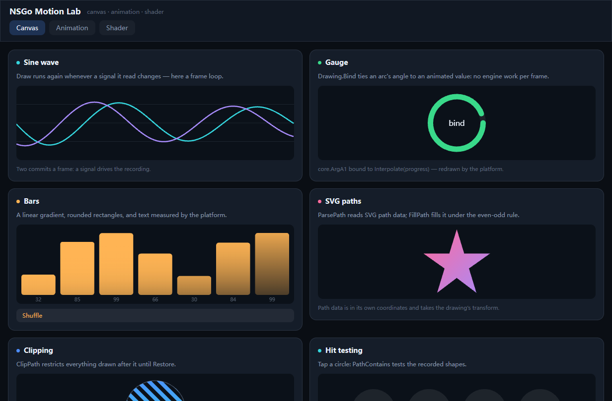

## 运行

```bash
# 热重载开发（默认原生窗口）
go tool nsgo dev .

# 跑在浏览器里
go tool nsgo dev -target web -open=false     # 打开 http://localhost:8080/

# 无头测试
go tool nsgo test .
go test .

# 出包
go tool nsgo build -target all -output dist
```

> Windows/Linux 上 `go build ./...` 会失败（`internal/platform/apple/edge.go` 缺少 `//go:build darwin`，是上游当前的问题）。只构建自己的包：`go build .`。

## 文件

| 文件 | 内容 |
| --- | --- |
| `app.go` | 12 个页签 + `core.Shader`／`core.Scroll` 骨架，`nsgo.Run(Root, nsgo.WindowSize(1180, 860))` |
| `theme.go` | 调色板、以及 `card` / `grid` / `chip` / `well` / `row` / `bezier` 等 60 行的小积木 |
| `page_canvas.go` | 6 个画布示例 |
| `page_animation.go` | 4 个动画示例 + 16 个 `core.MotionPreset` 网格 |
| `page_uikit.go` | 12 个组件级动效（ui 包 052/054/056–060/063/065/069–071：手风琴、Toast、开关…），页尾接 ui 包剩下的 12 张 |
| `fx.go` | 192 张动效卡片的驱动器：`FxSpec` + `Fx()` + `Disc/Panel/Ring/Word/At/Fill/Centered/StageRow` |
| `page_motion.go` · `page_motion2.go` | motion 包 001–024、121–144 |
| `page_camera.go` · `page_camera2.go` | camera 包 025–048、169–192；其中 5 张跑在 3D 场景上 |
| `page_uipack.go` | ui 包另外 12 张：049–051、053、055、061、062、064、066–068、072 |
| `page_lp.go` · `page_lp2.go` | lp 包 073–096、145–168 |
| `page_photo.go` | photo 包 097–120 |
| `page_shader.go` | 4 个 Kage 着色器示例 |
| `shader3d.go` · `page_3d.go` | 光线步进场景（相机＝uniform）＋ CPU 投影立方体 ＋ CSS 3D 翻面，9 张 |
| `app_test.go` | 无头测试：着色器编译 + 页签切换 + 控件交互 + 8 个动效包的首尾卡片 |

## 画布：`core.Canvas`

`Canvas.Draw func(d *Drawing, size Size)` 每次执行都会**重新录制**一遍绘制指令，`Drawing` 的方法与 web 的 `CanvasRenderingContext2D` 一一对应。

| 示例 | 演示的 API |
| --- | --- |
| Sine wave | `ticker` 驱动信号 → `Draw` 重跑；`BeginPath/MoveTo/LineTo/Stroke`、`SetLineGradient` |
| Gauge | **`d.Bind(core.ArgA1, animatedValue)`**：把圆弧终点绑到动画值，平台每帧重绘，引擎零工作 |
| Bars | `CanvasLinear` 渐变、`RoundRect`、`FillText` + `MeasureText`、`Shuffle` 改数据重录 |
| SVG paths | `core.MustParsePath` + `FillPath(path, core.EvenOdd)` |
| Clipping | `Save / Arc / Clip / Restore`，斜条纹只画在圆里 |
| Hit testing | `PathContains` 命中测试，点圆返回它的名字 |

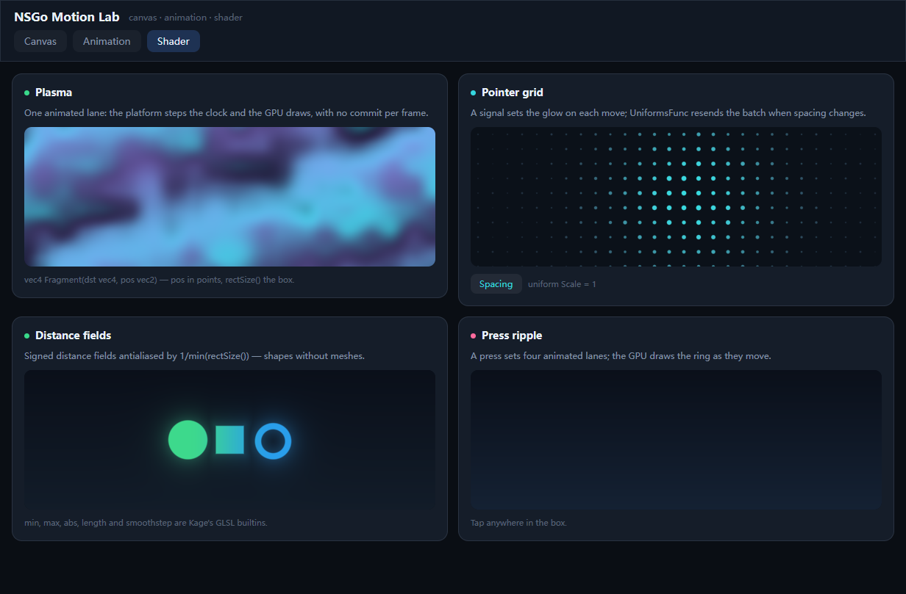

## 动画：`core.Timing` 家族

| 示例 | 演示的 API |
| --- | --- |
| Easing curves | `core.Timing` + `bezier(core.Linear/Ease/EaseOut/EaseInOut)` 四条轨道同跑 |
| Timing vs spring | `core.Timing{Duration}` vs `core.Spring{Stiffness, Damping, Mass}` |
| Keyframes | `core.ValueKeyframes` + `core.StopAt` + `core.Loop`（Web Animations 的 offset/value） |
| Composition | `core.Stagger` + `core.Sequence` + `core.Loop` 组合出交错波纹 |
| Motion presets | 16 个 `core.MotionPreset`，`core.NewMotion(cx, nil)` → `motion.Play(preset.Spec())` → `Style.Animated: motion.Style()` |

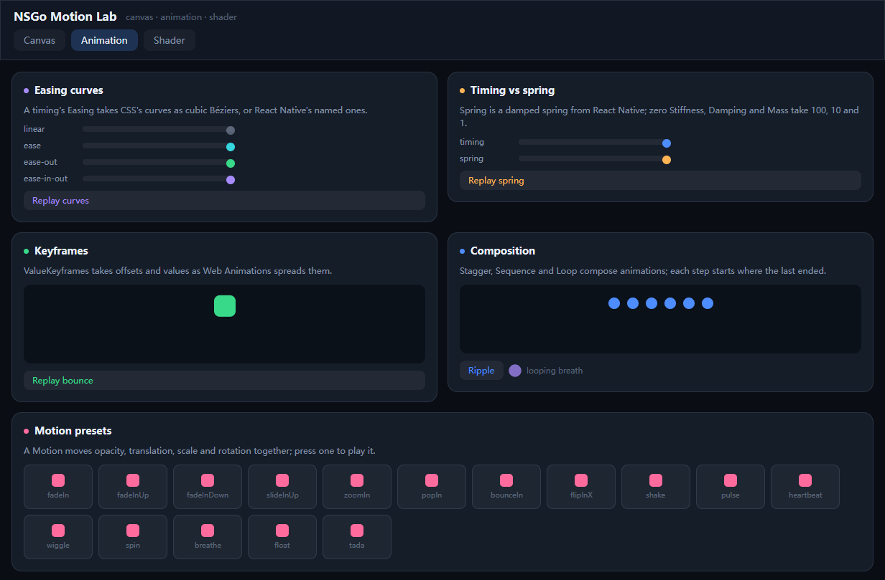

动画只改 `core.AnimatedStyle`（`TranslateX/Y`、`Scale`、`Rotate`、`Opacity`…）或 `core.AnimatedValue`，**一帧一个 commit**，不重跑 `Render`。

## UI 动效：组件级的动效怎么做

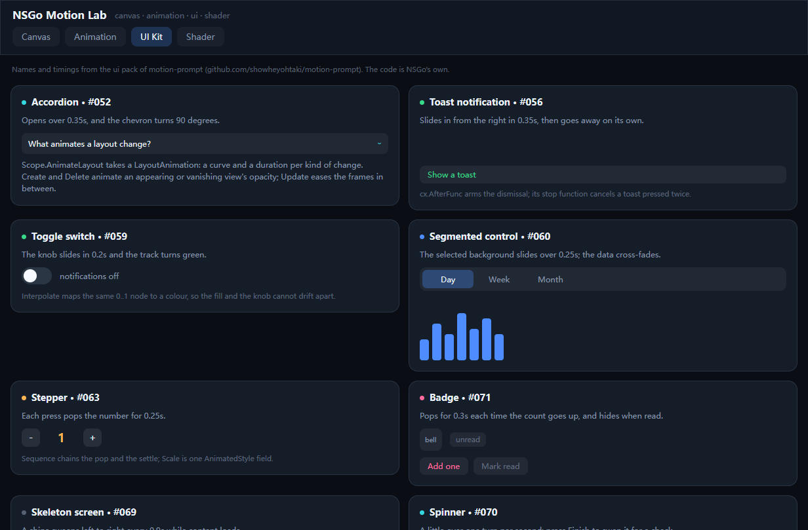

这 12 张卡片的**名字和时长**取自 [motion-prompt](https://github.com/showheyohtaki/motion-prompt)（MIT，一个「动效命名库」，8 个包共 192 个动效），代码全部用 NSGo 自己的原语重写——那个库的用途就是给这些效果起名，照着名字写即可。

| 卡片（编号同 motion-prompt） | 演示的 API |
| --- | --- |
| Accordion · #052 | `cx.AnimateLayout(core.LayoutAnimation{Update: {Curve, Duration}})` 让布局变化自己过渡；箭头用 `Timing` 转 90° |
| Toast notification · #056 | `cx.AfterFunc(2s)` 定时销毁 + `TranslateX/Opacity` 滑入；`stop` 函数取消上一次 |
| Toggle switch · #059 | `core.Interpolate(p, Interpolation{Input, Colors})` 把同一个 0..1 值映射成**颜色**，滑块用 `TranslateX` |
| Segmented control · #060 | 选中的背景块 `Absolute` + `TranslateX` 滑动；7 根柱子各自 `StyleFunc` 读当前周期 |
| Stepper · #063 | `core.Sequence(Timing 1.3, Timing 1)` 做出「弹一下再落回」 |
| Badge · #071 | `Show` + `Scale`；`Sequence` 的两段弹簧感 |
| Skeleton screen · #069 | `core.Loop(Timing, 0)` 永远循环 + 三条半透明带扫光，容器 `Overflow: Hidden` |
| Spinner · #070 | 只给 `Borders{Top, Right}` 上色 → 旋转起来就是弧；`core.Spring` 换成对勾 |
| Tooltip · #054 | `View.OnHoverIn/OnHoverOut` + `cx.AfterFunc(200ms)` 延迟显示 |
| Hamburger menu · #065 | 三条线各用一个 `AnimatedStyle`：`TranslateY` 合拢 + `Rotate` ±45° 变叉 |
| Tabs · #057 | 下划线 `Absolute` + `TranslateX` 250ms；内容 `Opacity` 交叉淡入 |
| Carousel · #058 | 整条 `Row` 的 `TranslateX` 做位移，圆点用 `StyleFunc` 跟着索引变色 |

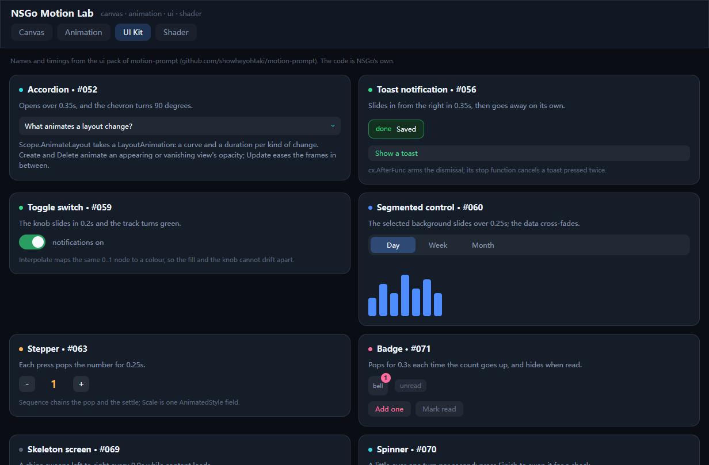

## 192 个动效：motion-prompt 目录的完整实现

[motion-prompt](https://github.com/showheyohtaki/motion-prompt)（MIT）把动效分成 8 个包、每包 24 个，一共 192 个并给每个起了名字。这个应用把 **192 个全部实现了一遍**，一个包一个页签：

| 页签 | 编号 | 包的内容 | 例子 |
| --- | --- | --- | --- |
| Motion | 001–024 | 入场、形变、文字、转场 | Pop-in、Stagger、Kinetic typography、Glitch |
| Camera | 025–048 | 镜头语言与剪辑 | Dolly zoom、Rack focus、Whip pan、J-cut |
| UI Kit | 049–072 | 组件交互（12 张是组件本身，12 张在页尾） | Modal、Bottom sheet、Stepper、Empty state |
| Landing | 073–096 | 落地页区块 | Hero、Pricing toggle、Bento、Loading skeleton |
| Photo | 097–120 | 布光与调色 | Rembrandt、Golden hour、Teal and orange、Film grain |
| Motion2 | 121–144 | 进阶动效 | Anticipation、Scramble、Pixelate、Shatter |
| Landing2 | 145–168 | 滚动 / 悬停 / 表单交互 | Stacking cards、Scrollspy、3D tilt、Inline validation |
| Camera2 | 169–192 | 运镜与蒙太奇 | Hyperlapse、POV、Bullet time、Montage |

复用范围只有**名字、分类和时长**：代码全部是 NSGo 自己的原语（`core.View` + `core.AnimatedStyle` + `core.Interpolate`），没有移植任何一行上游代码。

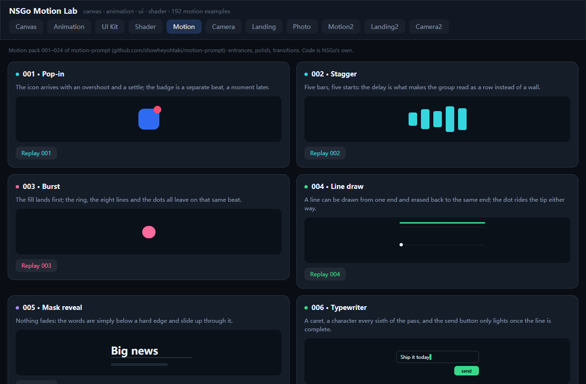

每张卡片都走同一个驱动器，所以第 193 个动效也只需要写 `Stage`：

```go
func pageMotion(cx *core.Scope) core.Node { /* … grid(Fx(...)) … */ }

return Fx(cx, FxSpec{
    ID: "001", Title: "Pop-in", Duration: 1200 * ms, Accent: colBlue, Height: 110,
    Note: "图标带一点过冲落位，徽章晚半拍跟上。",
    Stage: func(p *core.AnimatedValue) core.Node {
        // p 从 0 走到 1；舞台里所有位置都由它算出来。
        return core.View{Style: stageFill, Children: []core.Node{ /* … */ }}
    },
})
```

`Fx` 负责**自动播放一次**、给一个 Replay 小按钮、把卡片套进统一的 `card(...)`。`FxSpec` 还有 `Loop`、`PingPong`、`Width`（把舞台钉成 300pt 宽的「手机屏」并居中，落地页那些卡片用得上）。

写这些卡片时踩出来的三条规矩：

1. **舞台必须画得满**：stage 是一块固定高度的盒子，里面的形状都是绝对定位。绝对定位的子节点不参与父节点的高度计算，所以「没有样式、只有绝对子节点」的 wrapper 高度是 0——看上去就是一张空卡片。每条舞台要么直接返回一个绝对定位的元素，要么返回带 `stageFill` 的 wrapper。
2. **p == 1 的那一帧必须还能看**：卡片播完就停在 1，不会循环。凡是「出去再回来」的动效（Pixelate、Exploded view、Montage 的最后一格）都要让终点是最终状态，而不是起点。
3. **颜色插值的两端都要不透明**：`Interpolation.Colors` 里塞带 alpha 的颜色会渲染成接近纯色，不是半透明。

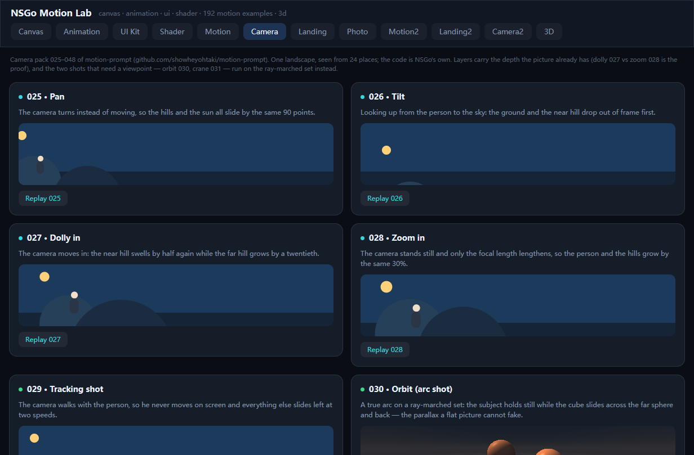
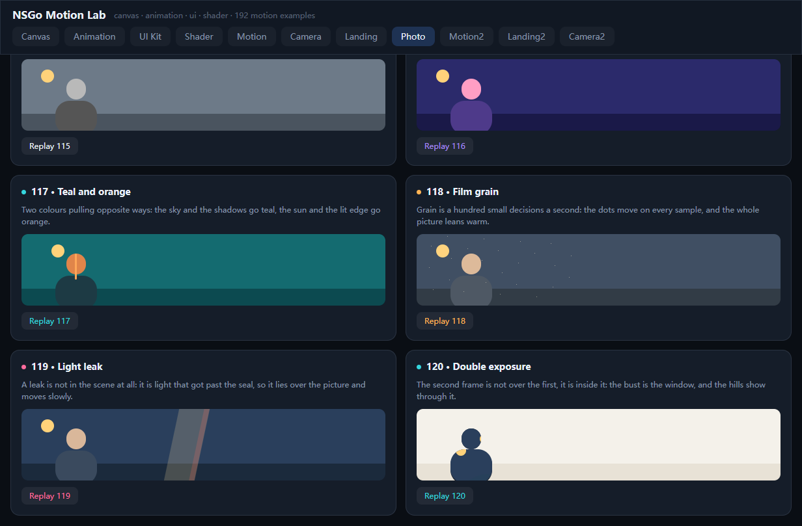

两条贯穿所有卡片的规则：

1. **状态信号只在闭包里读**（`Show.When`、`StyleFunc`、`ContentFunc`）。在 render 时读会让整棵子树重建，卡片里 `NewAnimatedValue` 出来的动画值会跟着重来一遍——表现就是「一按就跳回起点」。
2. **能只改样式就别改结构**：分段控件的柱子、标签页的文字、轮播的圆点都用 `StyleFunc` 读信号，一次改动只 restyle 这几个节点，不重新 render 整张卡片。

汉堡菜单按下去之后（三条线变叉、面板从上方落下）：

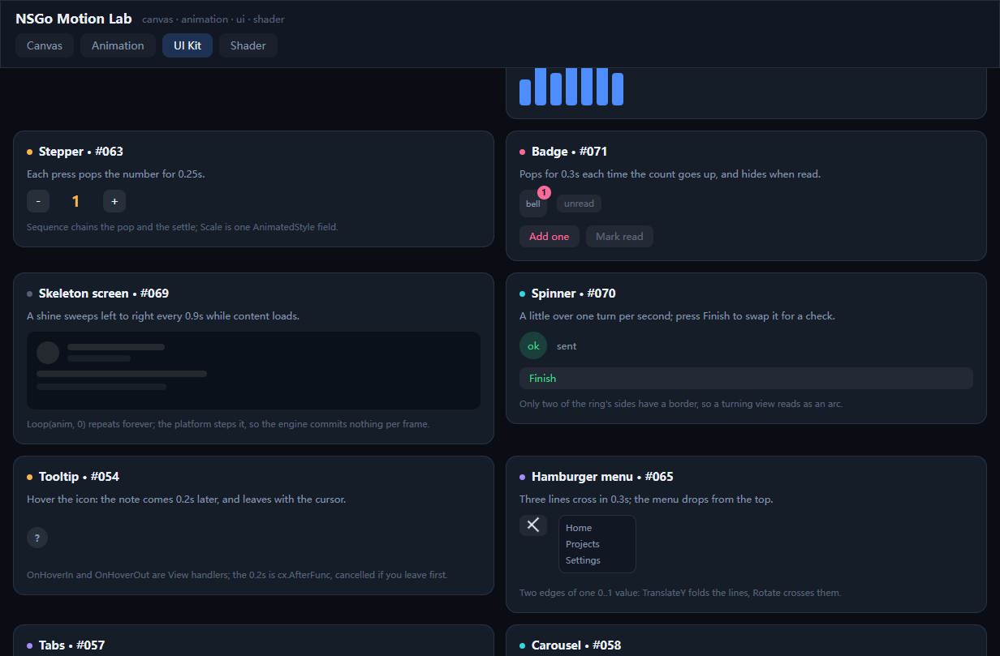

## 3D：NSGo 能做 3D 场景吗

能，但不是靠引擎。NSGo 里**没有**网格、没有顶点着色器、没有 Z 缓冲，也没有场景图，`core` 更不认 glTF。它有的是三样东西，各自能撑起一类 3D：

| 路子 | 真 3D？ | 代价 | 适合 |
| --- | --- | --- | --- |
| `core.Shader` 里光线步进（raymarching） | 是，逐像素求交 | 一个 Kage 程序，相机＝uniform，**零 commit** | 场景/镜头运动、体积、材质实验 |
| `core.Canvas` 里自己投影 | 是，顶点在 Go 里 | 每帧重录绘制指令（`Draw` 里读信号） | 需要命中测试、数据驱动的模型 |
| `Style.Perspective` + `RotateY/RotateX` | 伪 3D（CSS 3D） | 无 | UI 卡片、面板、翻面 |

「3D」页签把三条路各做了一遍：

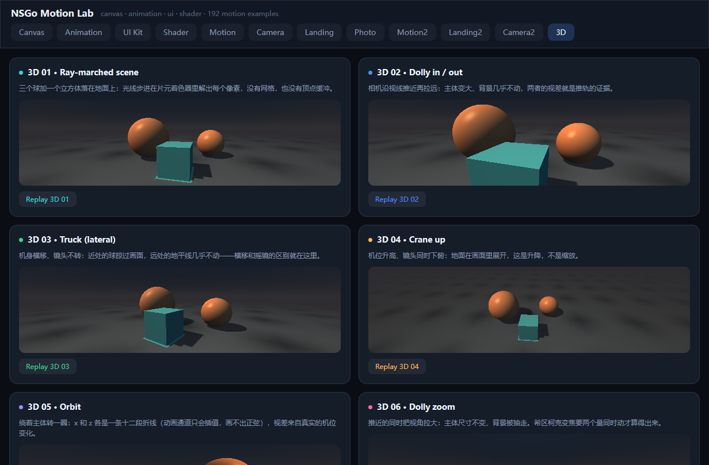
| 卡片 | 演示的点 |
| --- | --- |
| 3D 01 Ray-marched scene | 三个球 + 一个立方体 + 地面，96 步光线步进，软阴影靠 `shadowAt` 走一遍距离场 |
| 3D 02 Dolly in / out | 相机沿视线推近拉远：主体变大、背景几乎不动 |
| 3D 03 Truck (lateral) | 机身横移：近处扫过、远处几乎不动 |
| 3D 04 Crane up | 升降 + 下俯 |
| 3D 05 Orbit | 绕主体一圈，`sin`/`cos` 用十二段折线逼近（动画通道只会插值） |
| 3D 06 Dolly zoom | 推近 + 视角放大同时进行，主体尺寸不变、背景被抽走 |
| 3D 07 Pan (yaw) | 只转头，机位不动 |
| 3D 08 CPU projection | Go 里投影 8 个顶点、6 个面按深度排序、`core.Canvas` 画 |
| 3D 09 CSS 3D | `Style.Perspective` + `RotateY` 翻面（两张面按角度交叉淡入） |

这台相机不只在这个页签里用。camera 包那 5 张靠机位才成立的卡片——`030 Orbit`、`031 Crane up`、`176 Fly-through`、`179 POV`、`180 Over-the-shoulder`——直接复用 `cam3D` 和同一份 `rayProgram`，只是把 `shot3D.Height` 设成 110 跟别的卡片对齐：

| camera 卡片 | 相机怎么动 | 为什么非 3D 不可 |
| --- | --- | --- |
| 030 Orbit (arc shot) | `x`、`z` 各是一条 90° 圆弧折线，半径 2.4 | 绕过去才能看见另一侧，图层滑动只能假装 |
| 031 Crane up | 机位 `y` 0.42 → 2.55，看向点钉在主体上 | 升降会改变地平线，平图没有地平线可改 |
| 176 Fly-through | 对角穿过整个场景，看向点钉在场景中心 | 要的就是物体从镜头边擦过；终点仍留在场景里，不许停在空地上 |
| 179 POV | 低机位往前走，`y` 跟着脚步抖，两只手用同一条 lane | 第一人称要有「世界迎面来」，只晃画面不算 |
| 180 Over-the-shoulder | 机位贴着大球横移 0.54 | 前景被边缘裁掉、并且和后景不同速，这就是 OTS 的全部 |

写这几张时唯一的新坑：**穿场镜头不能只看前方**。第一版让 `Look` 钉在场景前方，飞过去之后画面就只剩空地——引擎没坏，是取景没了。改成「看向点钉在场景中心、机位斜穿过去」，终点自然落在场景背面，全程都有东西可看。

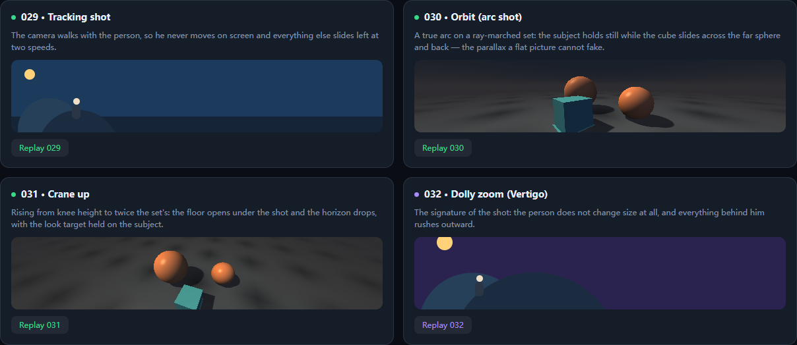
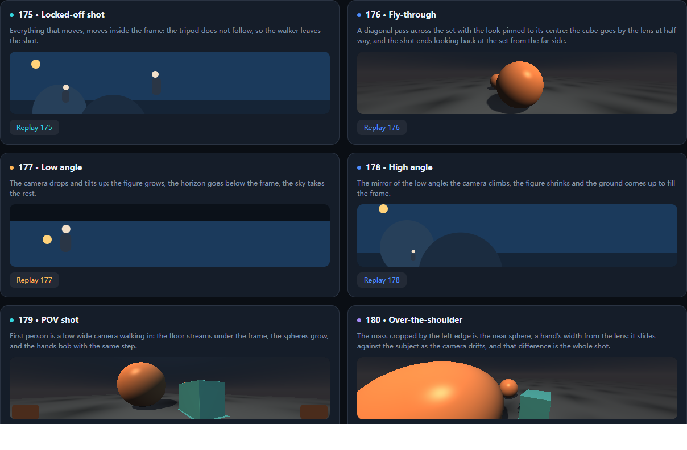

相机运动就是四个 uniform 的事，全是 `AnimatedNode`，平台按帧推进，`Root` 一次都不重渲染：

```go
var rayProgram = core.MustCompileShader(raySource) // Fragment 里 marching

core.Shader{
    Program: rayProgram,
    Style:   stageFill,
    Uniforms: core.Uniforms{
        "Eye":  []any{lerp(p, -1.7, 1.7), lerp(p, 0.92, 0.92), constant(cx, 2.45)},
        "Look": []any{constant(cx, 0.0), constant(cx, 0.50), constant(cx, 0.15)},
        "Fov":  constant(cx, 0.85),
        "Tint": lerp(p, 0.0, 1.0),
    },
}
```

写了才知道的四件事：

- **`Fov` 别当成缩放**：边缘那条光线偏离轴线的量是 `tan(fov/2)`，写成 `1/tan(fov/2)` 会把广角变成望远镜——第一版 9 张卡片全都在「越拉越远」，看着像 bug 其实是数学。
- **`BackfaceHidden` 在 web 上会把两面一起隐藏**：容器转到 204° 时前后面都成了背面，翻面卡直接空掉。所以 `3D 09` 用 `Opacity` 按角度交叉淡入淡出（`Interpolate` 在 0.24→0.26 处换手），`BackfaceHidden` 只是留给原生端。
- **没有 `preserve-3d`**：子节点永远在自己的平面里，所以 CSS 3D 做不了立方体（六个面得自己投影＋`ZIndex` 排序）——真要立方体就回到前两条路。
- **`AnimatedStyle` 里没有 `Perspective`**：透视要放在父节点的 `Style.Perspective` 上；旋转绕的是**节点自身中心**，所以一张全宽的卡片转 24° 会横跨半个屏幕——给它一个自己的尺寸。

> camera 包（025–048、169–192）里 48 张有 43 张是**二维**的：它挪的是一张分层风景图，近层大动、远层小动，`027 Dolly in` 近层 ×1.5 而 `028 Zoom in` 全体 ×1.3 就是这个模型的证明。剩下 5 张做不到——`030 Orbit`、`031 Crane up`、`176 Fly-through`、`179 POV`、`180 Over-the-shoulder` 要的是**机位在动**，图层滑动变不出另一侧的场景。这 5 张直接用 3D 页签那台光线步进相机，只是舞台高度从 150 换成 110（`shot3D.Height`），所以每个包页签的节奏没变。

## 着色器：`core.Shader`（Kage）

Kage 就是 Go 语法的 GLSL 分片着色器：入口 `Fragment(dst vec4, pos vec2) vec4`，`rectSize()` 给盒子尺寸，返回值是**预乘 alpha**。顶层的 `var Time float` / `var Press vec4` 就是 uniform，按字段顺序摊平成 lane。

| 示例 | 演示的点 |
| --- | --- |
| Plasma | 一个动画 lane 当时钟，GPU 自己画，零 commit |
| Pointer grid | 指针移动 → 写信号 → 光晕；`UniformsFunc` 换间距（这次会 commit） |
| Distance fields | SDF 画圆/方/环，`1/min(rectSize())` 做抗锯齿 |
| Press ripple | `Shader.OnPress` 只设置 4 个动画值（x, y, age, weight），GPU 画扩散的环 |

注意 `Uniforms` 里可以放 `[]core.AnimatedNode{x, y, ...}`，这样这些 uniform 由平台按帧推进；放普通值则只在重渲染时更新。`MustCompileShader` 在**运行时**编译，编译失败是 panic——所以 `app_test.go` 用 `core.CompileShader` 把每个源码都过一遍。

## 踩过的坑（都已验证）

- **`Scroll` 必须有被约束的高度**：`core.Scroll` 自己默认 `FlexShrink: 1`，但如果它上面那层 Column 只有 `FlexGrow: 1`，这个 Column 会撑到内容高度（View 的 `FlexShrink` 默认是 0，Yoga/RN 的规则），`Scroll` 于是一起变成内容高度——内部永远不溢出，**既没有滚动条也不滚动**。web 端的表现是浏览器在滚整个文档。修法是给那一层补 `FlexShrink: 1`（等价于 RN 的 `flex: 1`）。`TestScrollFitsWindow` 守着这个回归。
- **滚动条是覆盖式的**：native 端由平台自己画一个圆角滑块，滚动时淡入、停手后保持 700ms 再 300ms 淡出（`scrollbar.IndicatorHold`/`IndicatorFade`），不会占一条常驻的沟。web 端的滑块来自浏览器（`overflow-y: auto` + `scrollbar-width: auto`，`HideIndicator: true` 会变成 `none`）。
- `core.LineCapRound` 不存在，正确的是 `core.CapRound` / `core.JoinRound`。
- **绝对定位只给 `Left` 不给 `Width`，宽度是「剩余空间」**：tooltip 挂在 26pt 的圆形图标里（`Position: Relative`），`Left: 34` 之后可用宽度只剩负的/极小，结果文字被压成一列、每行一个字。给它一个显式 `Width` 就好。这条对「小锚点旁边挂一个浮层」都成立。
- **插值出来的背景色别带 alpha**：`Interpolate` 的 `Colors` 里放 `RGBA(0xffffff, 0.12)`，渲染出来是一条接近纯白的高亮轨道，不是 12% 的白。开关的轨道因此改成两个不透明色（`RGB(0x2b3644)` → `RGB(0x2a9d63)`）。
- `Style.AlignItems` 用 `core.AlignCenter`，但 `Style.JustifyContent` 用 `core.JustifyCenter`——两个不同的枚举。
- `core.Alpha(a)` 只能用在 `Style.Opacity`，颜色要透明用 `core.RGBA(hex, a)`。
- `core.Shader` 有 `OnPress`，但**没有** `OnMouseMove`；要跟随鼠标就把 `OnMouseMove` 放在包一层的 `core.View` 上（`Pointer grid` 就是这么做的）。
- `MotionPreset.Name()` 返回 camelCase（`fadeIn`），不是 `FadeIn`。
- 同一张卡片里的 `chip` 文字不能重复，`nsgotest` 的 `text:` 选择器会撞车——用 `id:`。
- **绝对定位的子节点不撑父节点**：一个只有绝对子节点的 `View`（没有 `Position`、没有 `Width/Height`）量出来是 0×0，里面的东西全被裁掉。192 张卡片里有 57 张一开始就是这么写的，画出来是一片空白。统一改成 `stageFill`（`Absolute` + 四边 0）就好了。
- **`AnimatedStyle` 的每个字段都是接口，不是数字**：`Scale: 1` 编译不过，`Scale: constant(cx, 1)` 才行；同理静态色要写成 `solid(cx, col)`（一个两端同色的 `Interpolate`）。`Width`/`Height` 不在 `AnimatedStyle` 里，要动宽度就动固定宽度元素的 `ScaleX`。
